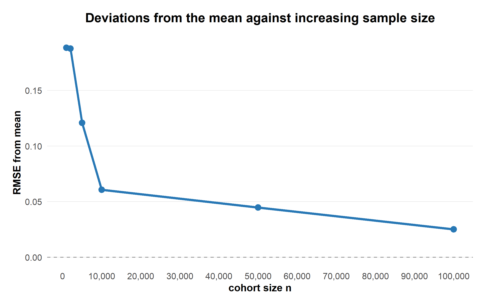

#+TITLE: rTMLE simulation study
#+SUBTITLE: An investigation of the bias in estimation of treatment-specific risks
#+OPTIONS: toc:2 num:t ^:nil
#+OPTIONS: html-style:nil html5-fancy:t
#+HTML_DOCTYPE: html5
#+HTML_HEAD: <link rel="stylesheet" href="style.css">
#+PROPERTY: header-args:R :session *R* :exports results

* Introduction

This study investigates the performance of a longitudinal targeted
maximum likelihood estimation (rTMLE) implemented in R on simulated
cohorts. The primary objective is to evaluate the bias of this
model, compared to the true* risk, in increasingly complicated
reference scenarios. The hope is to recreate and validate models
performance on LEADER-like data.

* Methods

** Data-generating mechanism

Setting (variables, events and their distributions), Hooks,
simulate_cohort. Maybe start everything with leader like just no 

** Evaluating true* risk (TR)

Large cohort. Maybe RMSE from mean for increasing sample size is a
good plot here (should just be necessary for one t0).

file:figures/reference_deviations_plot.png

Similarly if we change the reference to a different time.

** Performance measures

For an estimator $\hat{\theta}$ and true parameter
$\theta$, the bias is defined as

\[
\operatorname{Bias}(\hat{\theta})
=
\frac{E[\hat{\theta}] - \theta}{\theta}.
\]

RMSE from the same definitions etc. Think makes sense to normaliz
both cases.

\[
RMSE
=
\sqrt(\frac{1}{N} \sum_{n} (E_{n}[\hat{\theta}] - \theta)^2)
\]

* Simulation results

** Minimal setting

The minimal simulation setting includes randomized
treatment assignment (lira or placebo), an absorbing outcome (death),
and no effects further effects.

#+CAPTION: Distribution of estimates across simulations

** Interactive comparison

The figure below allows inspection of estimates
across simulation settings.

#+BEGIN_EXPORT html
<iframe
  class="simulation-widget"
  src="widgets/minimal_interactive.html"
  title="Interactive simulation results"
  loading="lazy">
</iframe>
#+END_EXPORT

* Additional analyses

[[file:minimal.org][Detailed minimal simulation results]]

* Discussion

Interpretation of the simulation results.

* Conclusions

Summary of the main findings.
