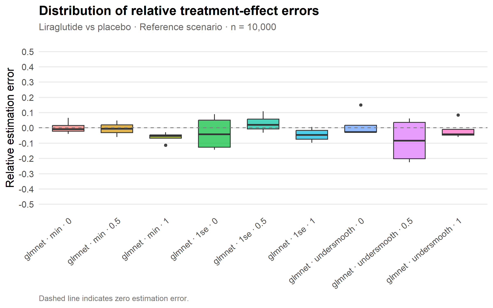
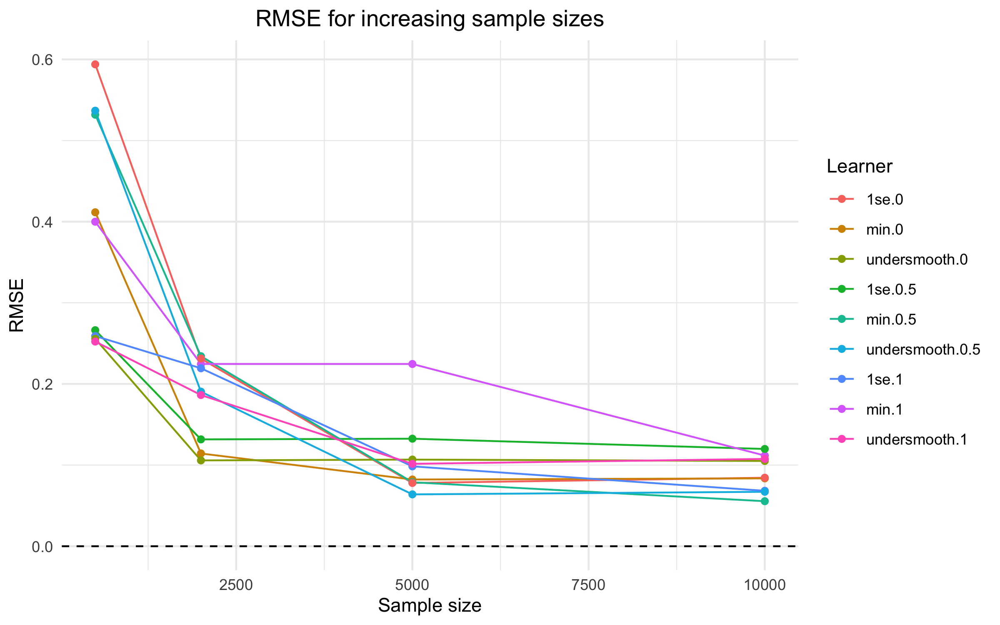
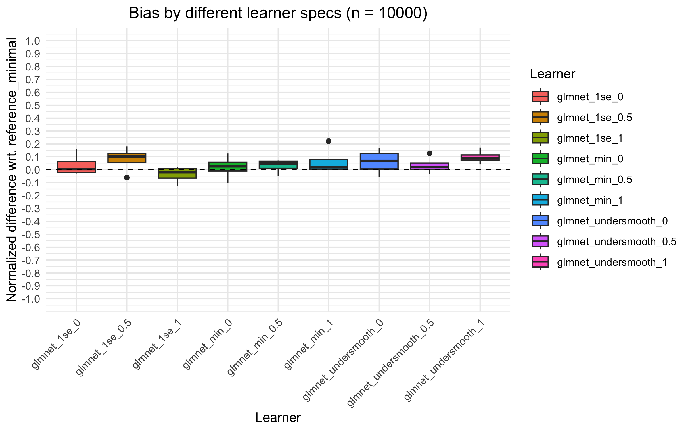

#+TITLE: rTMLE simulation study
#+SUBTITLE: An investigation of the bias in estimation of treatment-specific risks
#+OPTIONS: toc:2 num:t ^:nil
#+OPTIONS: html-style:nil html5-fancy:t
#+HTML_DOCTYPE: html5
#+HTML_HEAD: <link rel="stylesheet" href="style.css">
#+PROPERTY: header-args:R :session *R* :exports results
#+MACRO: bias @@html:bias@@
#+MACRO: rbias @@html:relative bias@@
#+MACRO: rmse @@html:RMSE@@
#+MACRO: rrmse @@html:relative RMSE@@

* Introduction

This study investigates the performance of a longitudinal targeted
maximum likelihood estimation (rTMLE) implemented in R on simulated
cohorts. The primary objective is to evaluate the bias of this
model, compared to the true* risk, in increasingly complicated
reference scenarios. The hope is to recreate and validate models
performance on LEADER-like data.

Points of interest include; confounding, censoring, ...

Note to Thomas - at some point analyses will be outlined in detail in
each of their own docs, while all important results will be here on main
page.

* Methods

The general framework is to generate a "register"-like cohort subject to two
different treatments (distributed based on the actual reference scenario) and
compare the rTMLE estimate on the difference in risk between the two treatment
protocols. The scenario treats treatment (~lira~) and placebo (~placebo~)
with the evaluated protocols being (at least for now) only one or the
other. Don't remember the exact structure of the LEADER data but i suspect there
are competing treatments as well (metformin) which could be included to look at
a protocol with the combined effect of the two in reference to the placebo.

** Data-generating mechanism

Setting (variables, events and their distributions), Hooks,
simulate_cohort. Maybe start everything with leader like data - just
no effects yet - thoughts Thomas?

Right now there are two available settings. The minimal with limited
amount of variables, and a LEADER setting with every variable of the actual
study included with distributions that seemed to make sense to me. The cohorts
generated with simulate_cohort.R look something like this;

#+begin_src R :session *R* :results output

#+end_src

#+RESULTS:

#+begin_src R :session *R* :results output

#+end_src

#+RESULTS:

The main difference
is the fact that the minimal is limited in time to baseline, one visit, and an
outcome. However am considering to just have everything be LEADER based but
change the scenario through the visit_schedule and max_follow i.e. by varying
the included time interval.

** Performance measures

Two primary performance measures are considered in the simulation study:
bias and root mean squared error (RMSE). These measures are used to evaluate
the accuracy of the estimators relative to the true parameter or a specified
reference value.

Let $\hat{\theta}_n(t)$ denote the estimate obtained in simulation run $n$ at
time $t$, and let $\theta(t)$ denote the corresponding true parameter. The total
number of simulation runs is denoted by $N$. Bias describes the systematic
deviation of an estimator from the true parameter. At a given time point $t$, it
is defined as

\[
\boxed{
\operatorname{Bias}(\hat{\theta}(t))
=
E[\hat{\theta}(t)] - \theta(t)
}
\]

where $E[\hat{\theta}(t)]$ denotes the expected value of the estimator across
repeated simulations. In practice, bias is estimated using the average of the
estimates across the $N$ simulation runs:

\[
\boxed{
\widehat{\operatorname{Bias}}(t)
=
\frac{1}{N}\sum_{n=1}^{N}\hat{\theta}_n(t) - \theta(t)
}
\]

To express the bias relative to the magnitude of the true parameter, the
/relative bias/ is defined as

\[
\boxed{
\widehat{\operatorname{Relative\ Bias}}(t)
=
\frac{
\frac{1}{N}\sum_{n=1}^{N}\hat{\theta}_n(t) - \theta(t)
}{|\theta(t) |}}
\]

This provides a proportional measure of systematic estimation error, provided
that $\theta(t) \neq 0$. A positive relative bias indicates overestimation,
while a negative relative bias indicates underestimation.  RMSE measures the
overall magnitude of estimation error across simulation runs, accounting for
both systematic bias and variability between estimates.

For a specified reference value $\theta^*(t)$, the RMSE is calculated as

\[
\boxed{
\operatorname{RMSE}(t;\theta^*)
=
\sqrt{
\frac{1}{N}
\sum_{n=1}^{N}
\left(
\hat{\theta}_n(t) - \theta^*(t)
\right)^2
}
}
\]

Here, $\theta^*(t)$ represents the reference value at time $t$, which may
be the true parameter or an approximation obtained from a separate set
of simulations. Similarly, the /relative RMSE/ is defined as

\[
\boxed{
\operatorname{Relative\ RMSE}(t;\theta^*)
=
\sqrt{
\frac{1}{N}
\sum_{n=1}^{N}
\left(
\frac{
\hat{\theta}_n(t) - \theta^*(t)
}{|\theta^*(t)|}\right)^2}}
\]

This expresses the RMSE as a proportion of the magnitude of the reference
value, provided that $\theta^*(t) \neq 0$.

*** Interpretation

Both bias and RMSE are included to provide complementary assessments of
estimator performance. Bias quantifies systematic overestimation or
underestimation, whereas RMSE captures the overall magnitude of estimation
errors, incorporating both bias and variability.

The relative versions of these measures allow estimation errors to be
interpreted proportionally to the magnitude of the true parameter or
reference value, facilitating comparisons across scenarios with different
parameter magnitudes.

All comparisons are performed at the same discrete time point $t$,
ensuring that estimates and their corresponding reference values represent
the same follow-up period.

Throughout the simulation study, the term /risk/ may be used as shorthand
for the difference in cumulative risk between the two treatment protocols,
unless otherwise specified.

** Evaluating true* risk (TR)

Large cohort. Maybe RMSE from mean for increasing sample size is a good plot
here (should just be necessary for one t0). To evaluate the appropriate sample
size of a cohort that allows calculating the actual risk the RMSE between a
naive (but true) risk estimate and its mean over a number of runs for increasing
sample sizes. The assumption is that the result converges well enough* toward the
true value at some finite sample size.

#+CAPTION: {{{rrmse}}} of estimates over 10 seeds from the mean risk estimate for increasing sample sizes.
file:figures/reference_deviations_plot.png

Similarly if we change the reference to a different time (will include these as
well - suspect convergence will happen quicker w.r.t. increases in sample size.

* Simulation results

** Minimal setting

** Minimal simulation scenario

The reference scenario considers two treatment protocols,
LIRA and PLACEBO, with death as the outcome.

#+INCLUDE: "generated/simple_scenario.html" export html

#+CAPTION: Distribution of {{{rrmse}}} of rTMLE estimates from reference for increasing sample sizes. Dashed line indicates that of the naive estimates
[[file:figures/rmse00.png]]

#+CAPTION: Distribution of {{{bias}}} between estimate and reference across simulations

Then, an additional absorbing outcome (censoring) is introduced in the form of
dropout. The 

#+CAPTION: Distribution of {{{rrmse}}} of rTMLE estimates from reference for increasing sample sizes. Dashed line indicates that of the KM estimates

#+CAPTION: Distribution of {{{bias}}} estimate and reference across simulations

Then, confounding.

Then, both censoring and confounding.

# ** Interactive comparison

# The figure below allows inspection of estimates
# across simulation settings.

# #+BEGIN_EXPORT html
# <iframe
#   class="simulation-widget"
#   src="widgets/minimal_interactive.html"
#   title="Interactive simulation results"
#   loading="lazy">
# </iframe>
# #+END_EXPORT

* Additional analyses

[[file:minimal.org][Detailed minimal simulation results]]

* Discussion

Interpretation of the simulation results.

* Conclusions

Summary of the main findings.
