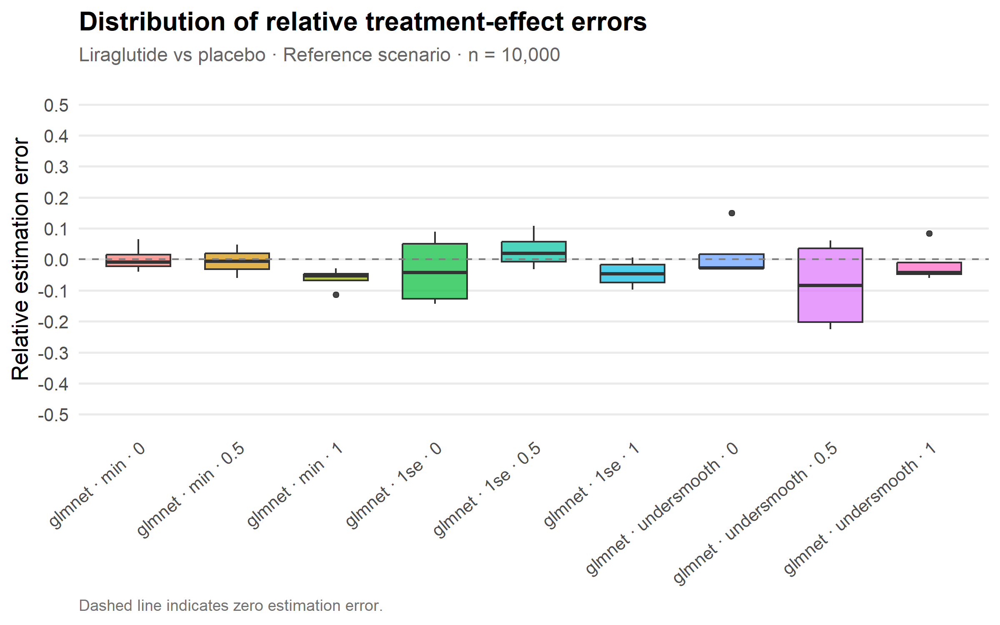
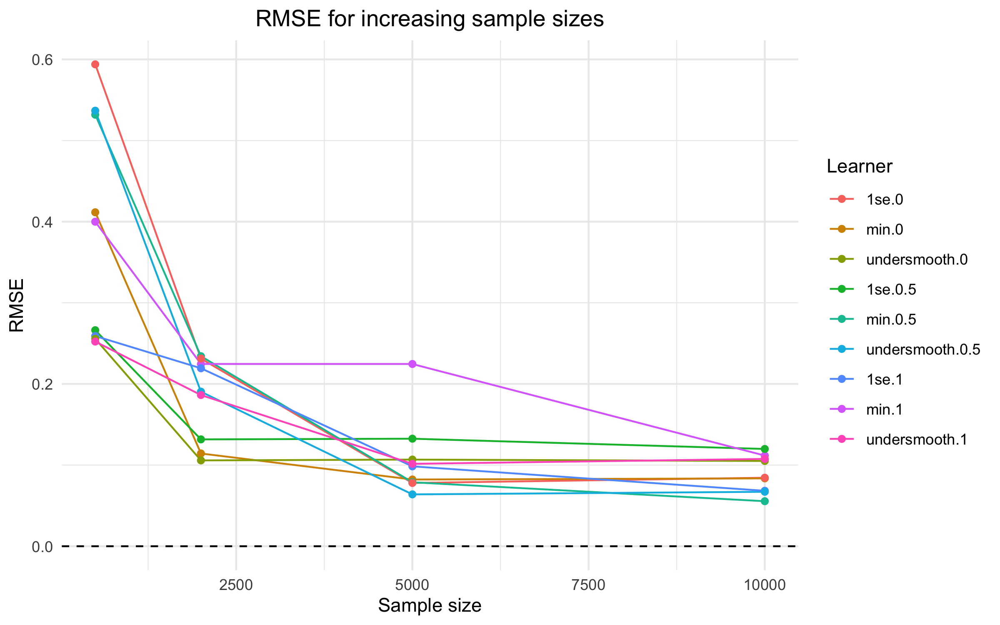
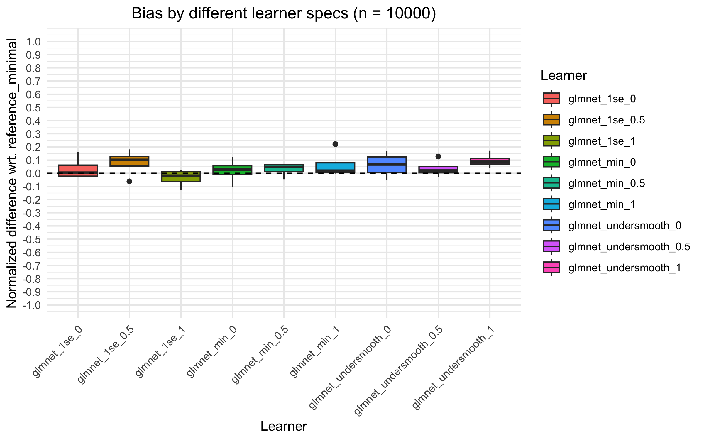

#+OPTIONS: toc:2 num:t ^:nil
#+OPTIONS: html-style:nil html5-fancy:t
#+HTML_DOCTYPE: html5
#+HTML_HEAD: <link rel="stylesheet" href="style.css">
#+PROPERTY: header-args:R :session *R* :exports results
#+MACRO: bias @@html:bias@@
#+MACRO: rbias @@html:relative bias@@
#+MACRO: rmse @@html:RMSE@@
#+MACRO: rrmse @@html:relative RMSE@@

The reference scenario considers two treatment protocols,
LIRA and PLACEBO, with death as the outcome.

#+INCLUDE: "generated/simple_scenario.html" export html

#+CAPTION: Caption {{rrmse}}
#+BEGIN_EXPORT html
<iframe
    src="widgets/rmse00.html"
    width="100%"
    height="600"
    style="border:none;">
</iframe>
#+END_EXPORT

#+CAPTION: Caption  {{rbias}}
#+BEGIN_EXPORT html
<iframe
    src="widgets/boxplot00.html"
    width="100%"
    height="600"
    style="border:none;">
</iframe>
#+END_EXPORT

#+CAPTION: Distribution of {{{rrmse}}} of rTMLE estimates from reference for increasing sample sizes. Dashed line indicates that of the naive estimates

#+CAPTION: Distribution of {{{rbias}}} between estimate and reference across simulations

Then, an additional absorbing outcome (censoring) is introduced in the form of
dropout. The 

#+CAPTION: Distribution of {{{rrmse}}} of rTMLE estimates from reference for increasing sample sizes. Dashed line indicates that of the KM estimates

#+CAPTION: Distribution of {{{rbias}}} estimate and reference across simulations

Then, confounding.

Then, both censoring and confounding.

